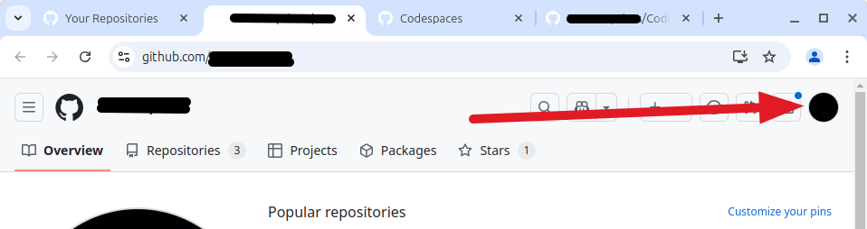
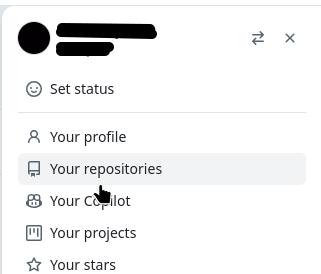
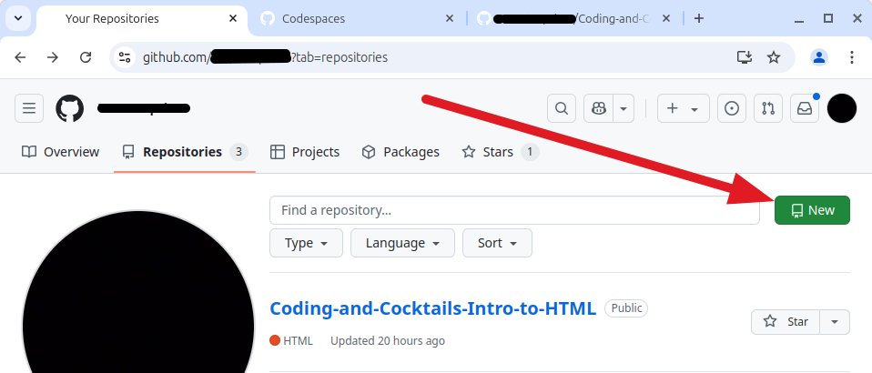
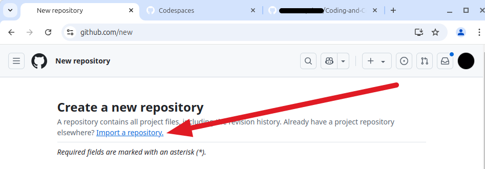
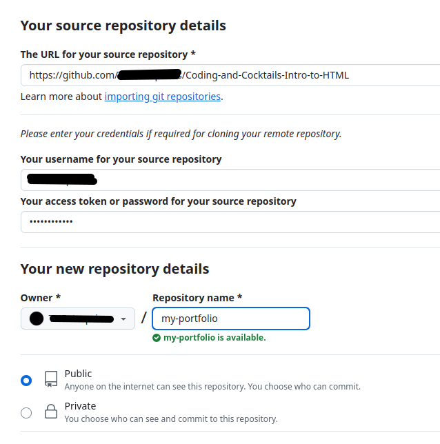
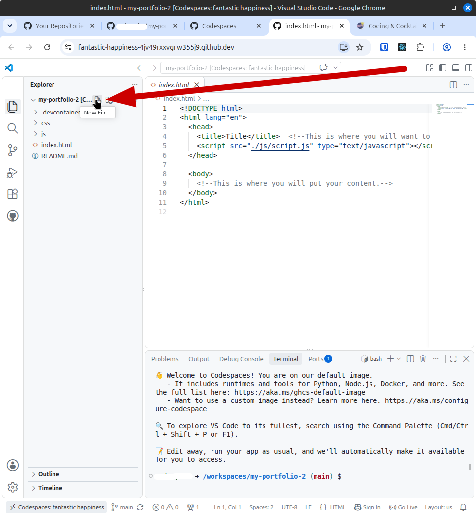

<div>
    
    <h2 style="display:inline-block;margin-top:1em;">Coding &amp; Cocktails: The Shaker</h2>
    <h3 style="margin-top:0;margin-bottom:2em;">Let's Build a Portfolio Website - HTML</h3>
</div>

# Setup

> [!TIP]
> Open [Slack](http://kcwit.slack.com/) to the **#codingandcocktails** channel. It's a great way to stay in touch with your Coding & Cocktails friends and to ask questions during and after the session. We'll also post updates and tips in Slack if we run in to any stumbling blocks today.
> 
> If you haven't signed up for our Slack, yet, please follow [this link](https://join.slack.com/t/kcwit/shared_invite/zt-4h07co9zk-4g27Xe6X_unLj4yUx0kYqg) to sign up.

> [!WARNING]
> We will use a cloud development environment called **GitHub Codespaces**. In order to use Codespaces, you will need a GitHub account. Codespaces **only** works with Chrome, so it is important that you use Google Chrome for today. If you use a different browser, things will not behave as this tutorial expects.

Navigate to [**GitHub**](https://github.com) to create a personal account or log in. Feel free to ask your mentor for help! When complete and logged in to GitHub, return here to continue the instructions.

## HTML

Go to your GitHub page (`https://github.com/<yourprofilename>`). Click on the **profile picture** in the upper right-hand corner of the page and select "**Your repositories**."





Now right click on the green "**New**" button in the upper right-hand corner and open it in a new tab.



Next, select the link that says "**Import a repository**."



Copy the following link address.

https://github.com/KansasCityWomeninTechnology/Coding-and-Cocktails-Portfolio

Return to the tab that has the import tool on it and paste the URL you just copied into the box for the source repository URL.

Ignore the "Your username for your source repository" and "Your access token or password for your source repository." (These are only needed if you're importing a repository that you own, that you have set to require a GitHub account and password to clone.)

Type something in the "**Repository name**" box, as well. You'll want to name the repo something like "**my-portfolio**" or "**portfolio**."

Make sure your repository is public, or no one will be able to see it!



Click "**Begin import**." It will take a minute or two for the repository to finish being imported.

Now go to your Codespaces page on GitHub and select the green "**New codespace**" button in the upper right-hand corner.

On the next page, select "**Select a repository**," then select the new repo you just created, then click the green "Create codespace" button.

The first thing that you will see is the README file for the repository. Delete the text that appears there and write something new. Generally, the README is to tell people what the repo is for.

Next, double-click on **index.html**. This is the file you will want to use to create content for the home page of your portfolio website.

It will look something like this:

index.html

    ``` <!DOCTYPE html>
        <html lang="en">
        <head>
            <title>Title</title>  <!--This is where you will want to name your page. -->
            <script src="./js/script.js" type="text/javascript"></script>  <!--This will import your JavaScript to your HTML file.-->
        </head>

        <body>
            <!--This is where you will put your content.-->
        </body>
        </html>
    ```
The *index.html* file is the file that displays the contents of your portfolio’s homepage. It is also the first page a visitor sees when viewing your website. There is already a basic structure inside, like the <head> section that holds details about the page, and the <body> section that holds everything the visitor sees. Right now, the page is blank and has no content. If you change what’s between the <body></body> tags, you will see text begin to appear on the page. Give it a try!

Potential employers want to get to know you and see your web development skills, so you'll want to add more pages to your website. Most portfolio sites include:

    - **Home** (index.html), including a short welcome message and a link to your other pages
    - **About** (about.html), with your name, a photo, and a short bio
    - **Contact** (contact.html), with your email and links to your social media profiles
  
Because you already built the homepage, we suggest creating About and Contact pages. After this session, you can add more pages to highlight the work you’ve done and projects you’ve contributed to!

Since you're going to be showing your web development skills, you'll likely want to add separate "**About**" and "**Contact**" pages, as well as other pages that you might decide to include.

To add a new page to your site, click on the "**New File**" icon and type the name of the page for the file name. Don't forget to add .html to the end of the file! For example, for an "About" page,  you'll want to name the file "about.html".



Add an "About" page and a "Contact" page, at the very least, and if you want, add another page or two.

Don't forget to commit your changes to your repo! 

A commit is a saved checkpoint in your repo's history. Without a commit, the work you complete today only exists on your computer.

Instructions can be found under **Source Control** in the sidebar. Open that link in a new page so it's easier to follow along.